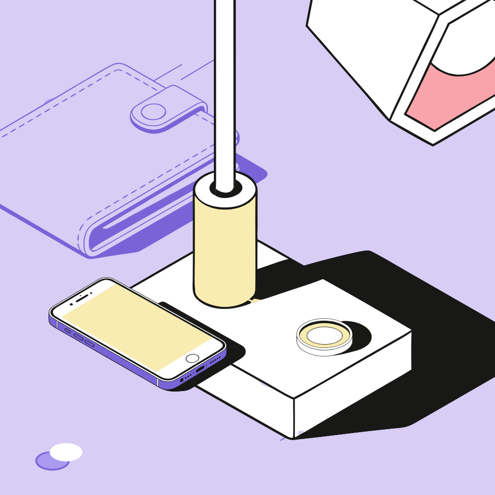

# Конструктор SVG-иллюстраций

Веб-сервис, который собирает композиции для иллюстраций из готовых объектов библиотеки (10 объектов в двух размерах и двух состояниях), перекрашивает их в выбранную цветовую схему и отдаёт результат векторным SVG. Сервис ничего не рисует и не меняет сами объекты: он только расставляет, поворачивает и красит их копии.

Стек: React 19, TypeScript, Vite, Tailwind CSS v4, shadcn/ui (Radix), Zustand, Vitest.

## Что умеет

- **Библиотека и холст.** Клик по объекту в библиотеке кладёт его в центр холста, а перетаскивание на холст — центром в точку, где отпустили. Дальше объект можно двигать, поворачивать, дублировать, удалять и менять порядок слоёв (кнопки, контекстное меню, клавиатура).
- **Размер у каждого объекта.** S и L — разные рисунки одного объекта; в одной композиции могут стоять и те и другие. Размер выбирается в свойствах объекта, а настройка «Размер новых объектов» задаёт размер для добавляемых и автособранных. Формат холста: 1000×1000, 1200×630 или 800×1200.
- **Слои.** Вкладка «Слои» показывает объекты сверху вниз; строки перетаскиваются, чтобы менять порядок.
- **Состояние объекта.** Главный (цветной) или фоновый (монохромный): переключается в свойствах.
- **Цветовые схемы.** Три готовые схемы из Figma и **загрузка своей палитры** из JSON с мгновенной перекраской всей композиции. Палитру можно править вручную (6 цветов) и скачать.
- **Сценарий 1: по метафоре или заголовку.** Подбор объектов, случайные (но воспроизводимые) размеры S/L и состояния главный/фоновый, автоматическая раскладка. Кнопка «Подобрать заново» даёт следующий вариант, переключатель «Разнообразить размеры и состояния» это отключает. Работает без LLM: подбор идёт по названиям, тегам и словарю смыслов (деньги, учёба, идея, команда, документы и т. д.), а запрос без совпадений получает универсальный набор с предупреждением.
- **Своя LLM (BYOK).** Подбор можно доверить любой модели со своим ключом: Anthropic, OpenAI, Google Gemini, OpenRouter, Groq, Ollama или любой OpenAI-совместимый сервис с собственным адресом. Ключ живёт только в памяти вкладки и уходит напрямую провайдеру; при любой ошибке сервис откатывается на локальный подбор и объясняет причину.
- **Сценарий 2: по названиям.** «Телефон, лампа, книга» → найденные объекты → композиция. Если объекта с таким названием нет («компьютер»), показываются близкие по смыслу с пометкой, а в композицию они не попадают без вашего клика.
- **Раскладка.** Три режима из Figma: «Собранно», «Со смещением», «Под заголовок»; кнопка «Другой вариант».
- **Экспорт.** Скачивание SVG: только векторные теги, объекты остаются сгруппированными и редактируемыми.

## Запуск

```bash
npm install
npm run dev        # http://localhost:5173
```

| Команда | Что делает |
|---|---|
| `npm run typecheck` | проверка типов (`tsc -b`; `vite build` типы не проверяет) |
| `npm run lint` | ESLint |
| `npm test` | тесты Vitest |
| `npm run build` | типы + production-сборка |
| `npm run preview` | предпросмотр собранной версии |
| `npm run examples` | пересобрать `examples/*.svg` тем же кодом, что и приложение |

## Примеры композиций

Собраны скриптом `npm run examples` через те же сценарии, раскладку и экспорт, что в приложении.

| Пример | Как собран |
|---|---|
| [`examples/startup-violet-1000x1000.svg`](examples/startup-violet-1000x1000.svg) | Сценарий 1: «Успешный стартап», фиолетовая схема, 1000×1000; размеры и состояния выбраны случайно |
| [`examples/study-mint-1200x630-headline.svg`](examples/study-mint-1200x630-headline.svg) | Сценарий 2: «Книга, наушники, ручка», мятная схема, S, 1200×630, «под заголовок» |
| [`examples/finance-sunset-800x1200.svg`](examples/finance-sunset-800x1200.svg) | Сценарий 1 (вариант 2) + загруженная палитра [`palette-sunset.json`](examples/palette-sunset.json), 800×1200 |



## Архитектура

### Хранение SVG

Библиотека лежит в репозитории как обычные файлы, бэкенд не нужен:

```
src/assets/library/
  L/main/<id>.svg      L/background/<id>.svg      объекты размера L: главные и фоновые
  S/main/<id>.svg      S/background/<id>.svg      то же для размера S
  backgrounds/{L,S}/scheme-{1,2,3}.svg            рисунок «Фона» для каждой из 3 схем
```

10 объектов (`book`, `phone`, `puzzle`, `coin`, `headphones`, `lamp`, `vase`, `wallet`, `folder`, `pen`) × 2 состояния × 2 размера = 40 файлов, плюс 6 фонов. Файлы выгружены из Figma как есть и **не оптимизируются** (никакого SVGO): геометрия копируется побайтно. Метаданные (название, теги на русском и английском) лежат в [`src/features/library/manifest.ts`](src/features/library/manifest.ts).

### Извлечение

[`assets.ts`](src/features/library/assets.ts) подключает файлы через `import.meta.glob(..., { query: '?raw' })` и отдаёт их строками. Загрузка ленивая: каждый файл — отдельный чанк (28–66 КБ), который скачивается при первом использовании. Промисы кэшируются, поэтому ими можно пользоваться из `use()` React 19 с `Suspense`. При смене размера или схемы React держит прежнюю картинку (`useDeferredValue`), пока не загрузится новая, поэтому холст не мигает.

Нужный файл выбирается при отрисовке по `(objectId, size, state)` самого объекта: на холсте он хранит `objectId`, `size` и `state`, поэтому у каждого объекта свой размер, а его смена не пересчитывает остальное и не теряет положение (новый файл подгружается заранее, объект не мигает). Рисунок фона всегда берётся из L-файлов: он растягивается на весь холст, и размеры объектов на него не влияют (S-фоны остаются в библиотеке и проверяются тестами).

### Переиспользование и перекраска

Файл библиотеки — исходник, а не рабочая копия: на холсте и в экспорте он каждый раз разбирается заново.

1. [`recolor.ts`](src/features/palette/recolor.ts) заменяет значения `fill` и `stroke` по слотам палитры. Объекты нарисованы в схеме 1, поэтому перекраска идёт всегда от неё (а не цепочкой), у каждого фона источник — его собственная схема.
2. Атрибуты геометрии (`d`, `viewBox`, `width`, `height`) не трогаются; чёрный, белый и `none` остаются как есть.
3. [`svg.ts`](src/shared/lib/svg.ts) разбирает корень файла и проверяет, что `viewBox` равен `0 0 width height`: иначе объект сместился бы при вставке в группу.
4. `id` внутри файлов (в выгрузке Figma это повторяющиеся «Vector» с искажёнными именами) удаляются; `id`, на которые есть ссылки `url(#…)` (например, `clipPath` у фона), получают префикс, чтобы ссылки остались рабочими.

Холст и экспорт используют одну и ту же подготовку разметки ([`scene/markup.ts`](src/features/scene/markup.ts)), поэтому на экране ровно то, что попадёт в файл.

### Сцена и экспорт

Состояние (Zustand): формат, размер, палитра, объекты, выбранный объект. Порядок слоёв — порядок в массиве объектов. Чистые операции над слоями вынесены в [`sceneOps.ts`](src/features/scene/sceneOps.ts) и покрыты тестами.

[`buildSvg.ts`](src/features/export/buildSvg.ts) собирает итог:

```
<svg xmlns viewBox="0 0 W H">
  <rect id="background-fill" …/>                         заливка цветом схемы
  <g id="background-decor" transform=…>…</g>             рисунок фона
  <g id="object-N" data-object data-state data-size transform>…</g>  по группе на объект, снизу вверх
</svg>
```

Растра нет: тестами проверяется отсутствие `<image>`, `foreignObject`, `data:image`.

### Подбор по метафоре и своя LLM

- **Без LLM.** [`search.ts`](src/features/library/search.ts) оценивает объекты по трём признакам: название (самый сильный), тег и связь по смыслу из словаря [`concepts.ts`](src/features/library/concepts.ts) (около 30 понятий со словами и весами 1–3). Падежи разбираются по общему началу слова, служебные слова отбрасываются. [`variation.ts`](src/features/compose/variation.ts) берёт лучшие совпадения, а если их мало, добирает логичных «спутников» (книга → ручка, лампа, наушники). Вариант 0 — самый вероятный набор, остальные выбирают из сильных кандидатов случайно; зерно зависит от текста и номера варианта, поэтому результат воспроизводим. Размеры и состояния тоже выбираются случайно с ограничениями: самый подходящий объект всегда главный, главных не меньше двух.
- **Своя LLM.** Провайдеры описаны в [`llm/providers.ts`](src/features/compose/llm/providers.ts) тремя семействами API: Anthropic (официальный SDK, подгружается лениво), Google Gemini и OpenAI-совместимый (его понимают OpenAI, OpenRouter, Groq, Ollama, Mistral, DeepSeek и многие другие, достаточно указать адрес). Запрос идёт прямо из браузера через `fetch` ([`llm/complete.ts`](src/features/compose/llm/complete.ts)); список моделей можно загрузить у провайдера. Ответ модели считается недоверенными данными: берутся только `id`, которые есть в библиотеке.
- **Безопасность ключа.** Ключ не сохраняется (в `localStorage` попадают только провайдер, модель и адрес), не попадает в сообщения об ошибках и сбрасывается при смене провайдера, чтобы его нельзя было отправить на чужой адрес. По открытому `http://` ключ не отправляется (кроме `localhost`).

## Обновление библиотеки

Положите свежие SVG из Figma в `src/assets/library/…` под теми же именами и запустите `npm test`: `library.test.ts` проверит полноту (46 файлов), чистоту разметки и принадлежность цветов к схемам. Для новой цветовой схемы добавьте её в [`schemes.ts`](src/features/palette/schemes.ts) и файлы фона.

Формат файла палитры:

```json
{ "name": "Закат", "bg": ["#fde2e4", "#fbb1bd", "#9d174d"], "obj": ["#fff1a8", "#8ecae6", "#d8f3dc"] }
```

## AI-инструменты, использованные при разработке

- **Claude Code** (модель Claude Sonnet 5.5): планирование, написание кода и тестов, проверка в браузере.
- **Figma MCP**: чтение файла задания, структуры библиотеки, образцов палитр и примеров композиций; выгрузка части SVG (книга, наушники, ручка, монеты, два фона). Из-за лимита MCP на тарифе Starter остальные файлы выгружены вручную из Figma.

## Структура

```
src/
  app/                  корневой компонент
  features/
    library/            манифест, загрузка файлов, поиск
    scene/              состояние, операции со слоями, разметка объектов, форматы
    canvas/             холст, объект, фон, рамка выделения
    palette/            схемы, перекраска, импорт/экспорт палитры, слоты
    compose/            раскладка, сборка, подбор по метафоре (локально и своя LLM: llm/)
    export/             сборка и скачивание SVG
    panels/             настройки, библиотека, слои, инспектор, диалог метафоры
  shared/               общие компоненты shadcn/ui и утилиты
examples/               готовые композиции и пример палитры
scripts/                сборка примеров
```
